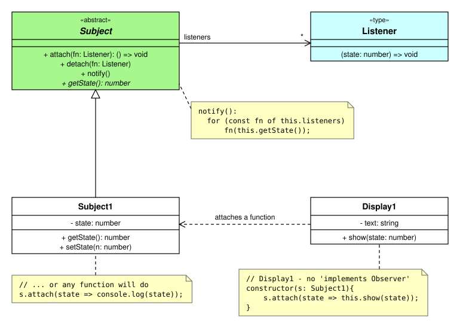
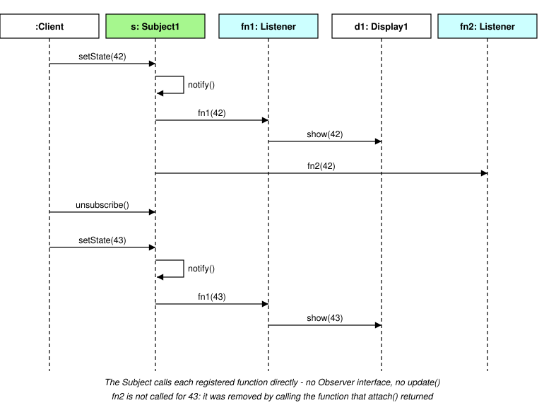

<style>
  .figures img { background: #ffffff; display: block; max-width: 100%; }
</style>

<div class="figures">

# Observer Pattern - Approach C: Observers as callback functions (TypeScript)

A modern alternative, very common in TypeScript / JavaScript.

In [Approach A](2_ObserverStoredSubject.md) and [Approach B](3_ObserverEventSource.md) every Observer is an **object** that implements an `Observer` interface with one method, `update()`. But an interface with a single method is really just describing a **function** - so in TypeScript we can skip the interface and attach plain functions instead:

- the Subject keeps a list of **functions** (often called *listeners* or *callbacks*)
- any function with the right signature can be attached - an arrow function, a method of some object, `console.log`, ...
- when the Subject changes, it simply **calls** each function, passing the new state (a **push** model)
- `attach()` returns an **unsubscribe** function - call it to detach

<hr>

## Class diagram

 void; Display1 attaches an arrow function">

Things to notice, compared with Approaches A and B:
- there is **no** `Observer` interface and no `Observer1`, `Observer2` classes
- instead there is a **function type** `Listener` - shown with the stereotype `«type»`, because in TypeScript it is declared with the `type` keyword
- `Display1` is an ordinary class - it does **not** implement anything. It just attaches an arrow function that calls its own `show()` method
- the new state is **pushed** to each listener, so nothing needs to call back to `getState()`

## Sequence of messages



<hr>

## Sample code

```
// Listener - the type of function that can observe a Subject
type Listener = (state: number) => void;
```

```
// Subject - keeps the list of listener functions, and calls each one when the state changes
abstract class Subject {
    private listeners: Listener[] = [];

    public attach(fn: Listener): () => void {
        this.listeners.push(fn);
        return () => this.detach(fn);   // hand back an "unsubscribe" function
    }

    public detach(fn: Listener): void {
        this.listeners = this.listeners.filter(x => x !== fn);
    }

    public notify(): void {
        for (const fn of this.listeners)
            fn(this.getState());        // push the new state to each function
    }

    public abstract getState(): number;
}
```

```
// (Concrete) Subject1 - calls notify() whenever its state changes
class Subject1 extends Subject {
    private state: number = 0;

    public getState(): number {
        return this.state;
    }

    public setState(newState: number): void {
        this.state = newState;
        this.notify();
    }
}
```

```
// Display1 - an ordinary class: no "implements Observer" needed
class Display1 {
    private text: string = "";

    constructor(subject: Subject1) {
        subject.attach(state => this.show(state));  // attach an arrow function
    }

    public show(state: number): void {
        this.text = `State is now ${state}`;
    }
}
```

```
// Client
const s = new Subject1();
const d1 = new Display1(s);
const unsubscribe = s.attach(state => console.log("log:", state));  // any function will do

s.setState(42);   // d1.show(42) is called, and "log: 42" is printed
unsubscribe();    // detach the logging function
s.setState(43);   // only d1 is updated now
```

<hr>

## Things to watch out for

### 1. Losing `this`

Passing a method directly does **not** work as expected:

```
subject.attach(this.show);    // WRONG - when called, 'this' inside show() is undefined
```

The function is called on its own, not *on* the `Display1` object. Wrap it in an arrow function (which keeps the surrounding `this`), or use `bind`:

```
subject.attach(state => this.show(state));   // arrow function - keeps 'this'
subject.attach(this.show.bind(this));        // also works
```

### 2. Detaching needs the *same* function

`detach()` compares function references with `!==`. A new arrow function - even with identical code - is a **different** function:

```
s.attach(state => console.log(state));
s.detach(state => console.log(state));   // does nothing - this is a NEW function
```

This is why `attach()` returns an unsubscribe function: it remembers the exact function that was attached.

### 3. Pull instead of push?

If listeners should pull the state themselves (like Approaches A and B), make the type `() => void` and let the function use the Subject it closes over:

```
type Listener = () => void;

s.attach(() => display.show(s.getState()));
```

<hr>

## Where you'll see it

- **Redux:** `store.subscribe(listener)` - and it returns an unsubscribe function, exactly like `attach()` above
- **Browser DOM:** `button.addEventListener("click", e => ...)` (detach with `removeEventListener`, which also needs the *same* function)
- **Node.js:** `emitter.on("data", data => ...)`
- **RxJS:** `observable.subscribe(value => ...)` returns a `Subscription` with an `unsubscribe()` method

<hr>

## Strengths
- very little code - no `Observer` interface, no `Observer` classes
- **anything** can observe - an arrow function, a method of any object, a library function
- the new state arrives as a parameter, so listeners don't need a reference back to the Subject
- the unsubscribe function returned by `attach()` makes detaching easy

## Weaknesses
- a listener is just a function, so it has no name or identity - harder to debug, and detaching needs the *same* function reference
- `this` is easy to get wrong when attaching methods
- the design is less visible in UML - there are no Observer classes to draw, so the relationships live in the code

<hr>

## Code example

Runnable versions of this approach:

- **terminal** (simple - one Observer): [code_examples_terminal/observer_c_callbacks](code_examples_terminal/observer_c_callbacks/README.md)
- **web** (a Celbridge / Deno browser project): [code_examples_web/observer_c_callbacks](code_examples_web/observer_c_callbacks/README.md)

Both use a temperature sensor (the Subject). The **web** version has two Observers - a JSON log, and a HOT / WARM / COOL / COLD display - plus a button for each temperature from -1°C to 30°C. The **terminal** version has just the category Observer, and reads temperatures from the keyboard - adding the JSON log Observer is an exercise in its README.

<hr>

## Java version

There is no Java version of Approach C - it relies on TypeScript function types. Java versions of Approaches A and B are in [java_version](java_version/ObserverPatternOverview_java_code.md).


</div>
