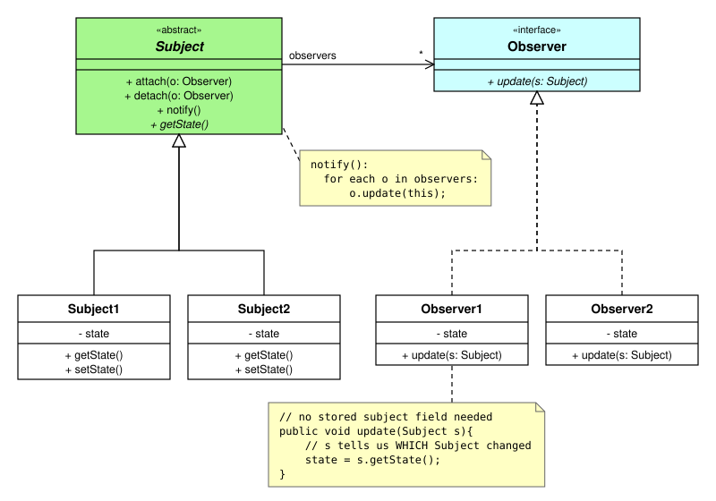
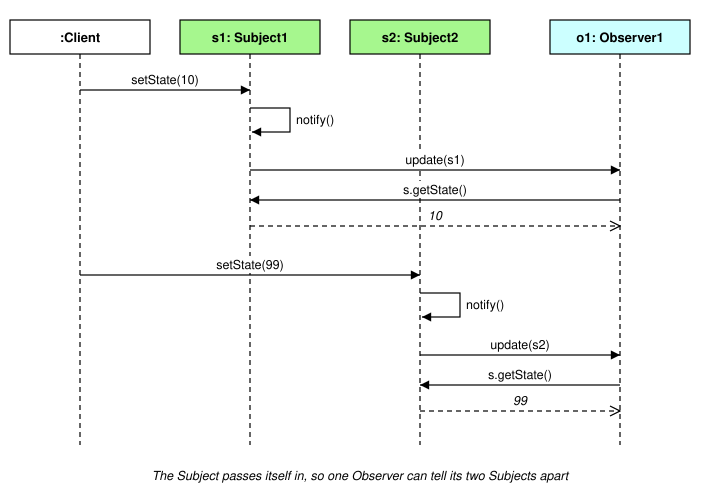

<style>
  .figures img { background: #ffffff; display: block; max-width: 100%; }
</style>

<div class="figures">

# Observer Pattern - Approach B: the Subject passes itself as the event source

In this approach the Subject passes a reference to **itself** with every update message - `o.update(this)`.

- Observers do **not** need to store a reference to a Subject
- one Observer can observe **several** Subjects, and still tell which one changed
- this is the style used by most real-world libraries (Java Swing / JavaBeans listeners, C# events)

<hr>

## Class diagram



Things to notice, compared with [Approach A](ObserverStoredSubject_java_code.md):
- `update(s: Subject)` now has a parameter
- there is **no** association from the Observers back to a Subject
- the abstract Subject declares an abstract `getState()`, so an Observer can call `s.getState()` on any Subject

## Sequence of messages - one Observer, two Subjects



<hr>

## Sample code

```
// Subject - broadcast notify(this) messages to all Observers
abstract class Subject {
    private List<Observer> observers = new ArrayList<>();

    public void attach(Observer o){
        observers.add(o);
    }

    public void detach(Observer o){
        observers.remove(o);
    }

    public void notify(){
        for each o in observers:
            o.update(this);         // pass a reference to myself
    }

    public abstract int getState(); // so Observers can call getState() on ANY Subject
}
```

```
// (Concrete) Subject1 - Subject2 is written the same way
class Subject1 extends Subject {
    private int state;

    public int getState(){
        return state;
    }

    public void setState(int newState){
        state = newState;
        notify();
    }
}
```

```
// Observer - update() receives the Subject that changed
interface Observer {
    void update(Subject subject);
}
```

```
// (Concrete) Observer1 - can observe more than one Subject
class Observer1 implements Observer {
    private int state1;
    private int state2;

    public void update(Subject subject){
        // the parameter tells us WHICH Subject changed
        if (subject instanceof Subject1)
            state1 = subject.getState();
        else if (subject instanceof Subject2)
            state2 = subject.getState();
    }
}
```

```
// Client
Subject1 s1 = new Subject1();
Subject2 s2 = new Subject2();
Observer1 o1 = new Observer1();

s1.attach(o1);
s2.attach(o1);    // one Observer, two Subjects

s1.setState(10);  // o1 receives update(s1)
s2.setState(99);  // o1 receives update(s2)
```

<hr>

## What if the abstract Subject has no getState()?

Then the parameter type `Subject` does not have a `getState()` method, and the Observer has to **cast** to the concrete class:

```
// (Concrete) Observer1 - without an abstract getState() in Subject
class Observer1 implements Observer {
    public void update(Subject subject){
        Subject1 s1 = (Subject1) subject;   // cast needed - getState() is only on Subject1
        state = s1.getState();
    }
}
```

The cast works, but it ties the Observer to `Subject1` again - and fails at runtime if a different kind of Subject is passed in.

<hr>

## Variation: an event object (push model)

Real frameworks usually wrap the source **and** the new data in an *event object*. The Observer then often doesn't need to call back at all - the data is **pushed** to it.

```
// Event object - carries the source AND the new data
class StateChangeEvent {
    private Subject source;
    private int newState;

    public StateChangeEvent(Subject source, int newState){
        this.source = source;
        this.newState = newState;
    }

    public Subject getSource(){ return source; }
    public int getNewState(){ return newState; }
}
```

```
// Subject - notify() now sends an event object
public void notify(){
    for each o in observers:
        o.update(new StateChangeEvent(this, getState()));
}
```

```
// (Concrete) Observer1 - the new state arrives inside the event
class Observer1 implements Observer {
    public void update(StateChangeEvent e){
        state = e.getNewState();    // no call back to the Subject needed
        ... e.getSource() is still available if we need to know who sent it
    }
}
```

Real-world examples of this style:
- Java: `PropertyChangeListener.propertyChange(PropertyChangeEvent evt)` - `evt.getSource()`, `evt.getNewValue()`
- Java Swing: `ActionListener.actionPerformed(ActionEvent e)` - `e.getSource()`
- C#: event handlers `(object sender, EventArgs e)`

<hr>

## Strengths
- one Observer can observe many Subjects, and knows which one sent each update
- Observers don't need a stored Subject reference just to receive updates

## Weaknesses
- the parameter has the **abstract** type `Subject`, so either the abstract Subject must declare `getState()`, or the Observer must cast
- the Observer still needs a reference from *somewhere* if it wants to `attach()` / `detach()` itself

<hr>

## Code example

A runnable version of this approach - a Java program (JDK only) that serves the page: [code_examples/observer_b_event_source](code_examples/observer_b_event_source/README.md)

The example is a temperature sensor (the Subject) with two Observers - a JSON log, and a HOT / WARM / COOL / COLD display - plus a button for each temperature from -1°C to 30°C.

<hr>

## TypeScript version

This is the Java reference version. The main version, with TypeScript code, is [3_ObserverEventSource.md](../3_ObserverEventSource.md)


</div>
