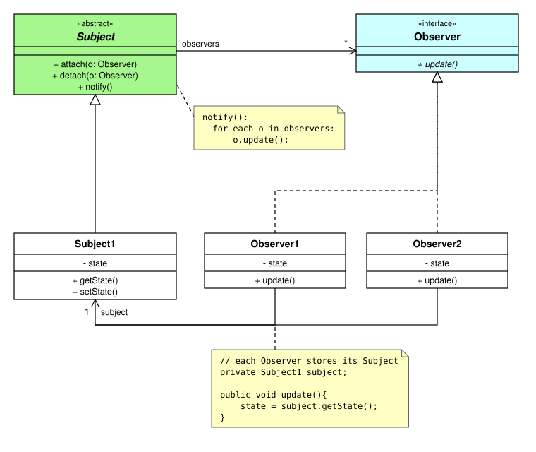
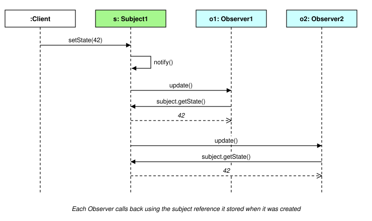

<style>
  .figures img { background: #ffffff; display: block; max-width: 100%; }
</style>

<div class="figures">

# Observer Pattern - Approach A: each Observer stores a reference to its Subject

This is the structure from the original Gang of Four (GoF) book.

- the Subject keeps a list of its Observers
- each Observer keeps a reference to the **one** Subject it is observing
- when the Subject changes, it sends a plain `update()` message (no parameters)
- each Observer then uses its stored `subject` reference to ask for the new state (`subject.getState()`)

<hr>

## Class diagram



Note the **two** directed associations:
- Subject -> Observers (`observers`, many `*`) - so the Subject can notify them
- Observers -> Subject1 (`subject`, exactly `1`) - so each Observer can call back to get the state

## Sequence of messages when the Subject's state changes



<hr>

## Sample code

```
// Subject - keeps the list of Observers, and broadcasts update() messages to them
abstract class Subject {
    private List<Observer> observers = new ArrayList<>();

    public void attach(Observer o){
        observers.add(o);
    }

    public void detach(Observer o){
        observers.remove(o);
    }

    public void notify(){
        for each o in observers:
            o.update();
    }
}
```

```
// (Concrete) Subject1 - calls notify() whenever its state changes
class Subject1 extends Subject {
    private int state;

    public int getState(){
        return state;
    }

    public void setState(int newState){
        state = newState;
        notify();
    }
}
```

```
// Observer - update() has NO parameters
interface Observer {
    void update();
}
```

```
// (Concrete) Observer1 - stores a reference to the Subject1 it is observing
class Observer1 implements Observer {
    private Subject1 subject;
    private int state;

    public Observer1(Subject1 subject){
        this.subject = subject;
        subject.attach(this);       // register with the Subject
    }

    public void update(){
        state = subject.getState(); // use the stored reference to pull the new state
    }
}
```

```
// Client
Subject1 s = new Subject1();
Observer1 o1 = new Observer1(s);
Observer2 o2 = new Observer2(s);

s.setState(42);   // o1 and o2 both receive update(), and each calls s.getState()
```

<hr>

## Strengths
- simple `update()` interface
- the Observer's field can have the **concrete** type (`Subject1`), so `getState()` can be called without a cast
- the stored reference is also needed anyway to `attach()` / `detach()` the Observer

## Weaknesses
- each Observer is tied to **one** Subject, chosen when it is created
- if an Observer watched two Subjects, a plain `update()` would not say *which* one changed
  - see [Approach B - the Subject passes itself as the event source](ObserverEventSource_java_code.md)

<hr>

## Code example

A runnable version of this approach - a Java program (JDK only) that serves the page: [code_examples/observer_a_stored_subject](code_examples/observer_a_stored_subject/README.md)

The example is a temperature sensor (the Subject) with two Observers - a JSON log, and a HOT / WARM / COOL / COLD display - plus a button for each temperature from -1°C to 30°C.

<hr>

## TypeScript version

This is the Java reference version. The main version, with TypeScript code, is [2_ObserverStoredSubject.md](../2_ObserverStoredSubject.md)


</div>
